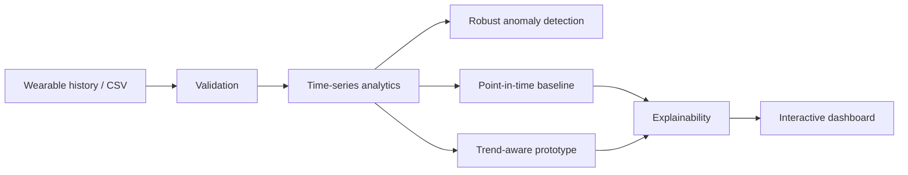

# PulseLens — Wearable Wellness Analytics

**Status: Wellness analytics research prototype · Non-diagnostic**

**[Live Demo](https://swethaa-pulselens.onrender.com) · [Model Card](docs/MODEL_CARD.md) · [Security](docs/SECURITY.md) · [Architecture](docs/ARCHITECTURE.md)**

PulseLens explores **longitudinal wearable-signal analytics**: daily readings are converted into trends, anomaly flags, explainable score contributions and multiple prototype wellness perspectives.

> **Medical boundary:** this is an educational analytics project. It is not a medical device, does not diagnose or predict a heart attack, and must not be used for emergency or clinical decisions.

## What the product does

- imports wearable history from CSV
- visualises resting-heart-rate and HRV trends
- detects unusual readings with median absolute deviation
- compares point-in-time and trend-aware prototype scores
- explains which features move the score
- supports longitudinal forecasting/recovery-style analytics
- exposes a Flask dashboard and API
- runs with Docker, product/API tests and CI

## Why longitudinal signals?

A single wearable reading can be noisy. PulseLens therefore focuses on changes over time and robust anomaly detection rather than treating one measurement as a diagnosis.

## Architecture



## API

`POST /api/analyse`

```json
{"age":42,"readings":[{"date":"2026-10-25","resting_hr":72,"hrv_ms":52,"sleep_hours":7.1,"steps":8200,"exercise_minutes":25,"spo2":98}]}
```

At least three readings are required.

## Run locally

```bash
pip install -r requirements.txt
python app.py
```

Then open `http://localhost:5000`.

## Research integrity

The repository uses synthetic/demo data and transparent scoring. It deliberately avoids unsupported claims of clinical accuracy, sensitivity, specificity or calibrated event probability.

A research-grade extension would require ethically sourced labelled data, prospective validation, calibration, subgroup analysis, medical oversight and regulatory review.

## Naming note

The product itself is correctly framed as **PulseLens / wearable wellness analytics**. The current GitHub repository slug predates that safer framing; issue #1 tracks renaming the repository so the URL/title no longer implies validated heart-attack prediction.
