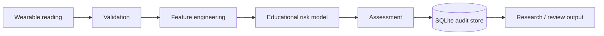

# Heart Attack Prediction Using Smartwatch Wearables

A complete educational portfolio system for transforming wearable-style signals into an explainable cardiovascular-risk screening score, with persistence, audit history, testing and safety documentation.

> **Important:** this is not a medical device, does not diagnose heart attacks and must not be used for emergency triage or clinical decisions.

## What this repository contains
- wearable feature validation and engineering
- transparent baseline risk-scoring model
- synthetic demonstration data
- SQLite storage for participants, readings, assessments and model versions
- ER/data-flow diagrams and data dictionary
- automated model and storage tests
- CI
- deployment/runbook notes
- privacy, clinical-safety and model-card documentation
- formal technical report

## Workflow


## Run
```bash
python demo.py
python -m unittest discover -s tests -v
```

## Database
```bash
python -c "from src.storage import init_db; init_db('wearable_risk.db', seed=True)"
```

## Structure
`src/` model and storage code · `database/` SQL assets · `data/` synthetic samples · `tests/` validation · `docs/` architecture/database/API/testing/deployment/security/model card/report.

## Safety boundary
No diagnostic accuracy, sensitivity, specificity, clinical validity or regulatory-compliance claim is made. Real medical use would require clinically appropriate datasets, medical oversight, prospective validation, subgroup analysis, privacy controls, human interpretation and regulatory review.
