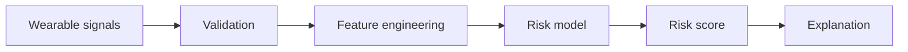

# Heart Attack Prediction Using Smartwatch Wearables

An educational machine-learning prototype exploring how wearable signals can be transformed into a cardiovascular-risk screening score.

## Features
- wearable-style inputs: resting heart rate, activity, sleep, age and HR variability
- transparent preprocessing and feature checks
- reproducible baseline risk model
- synthetic sample dataset for demonstration
- tests, CI, architecture and technical report

## Architecture


## Run
```bash
python demo.py
python -m unittest discover -s tests -v
```

## Safety
This repository is an educational portfolio prototype. It is not a medical device, does not diagnose heart attacks, and must not be used for clinical decisions or emergency triage.
