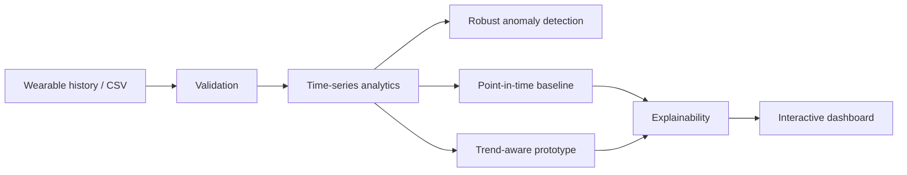

# PulseLens — Wearable Wellness Analytics

A high-end portfolio prototype for **longitudinal wearable-signal analytics**. PulseLens converts daily wearable readings into trend views, robust anomaly flags, explainable score contributions and multiple prototype risk perspectives.

> **Important:** this is an educational wellness analytics project. It is not a medical device, does not diagnose or predict a heart attack, and must not be used for emergency or clinical decisions.

## Product experience
- interactive Flask dashboard
- CSV import for wearable history
- resting-heart-rate and HRV trend visualisation
- robust anomaly detection using median absolute deviation
- trend-aware scoring alongside the original point-in-time baseline
- feature-contribution view for explainability
- model-comparison panel without unsupported accuracy claims
- responsive UI with no front-end framework dependency
- health endpoint, product API tests, Docker packaging and CI

## Run
```bash
pip install -r requirements.txt
python app.py
```
Then open `http://localhost:5000`.

## API
`POST /api/analyse`
```json
{"age":42,"readings":[{"date":"2026-10-25","resting_hr":72,"hrv_ms":52,"sleep_hours":7.1,"steps":8200,"exercise_minutes":25,"spo2":98}]}
```
At least three readings are required.

## Core architecture


## Portfolio integrity
The repository uses synthetic/demo data and transparent scoring. It deliberately avoids unsupported claims of clinical accuracy. A research-grade extension would require ethically sourced labelled data, prospective validation, calibration, subgroup analysis, medical oversight and regulatory review.
