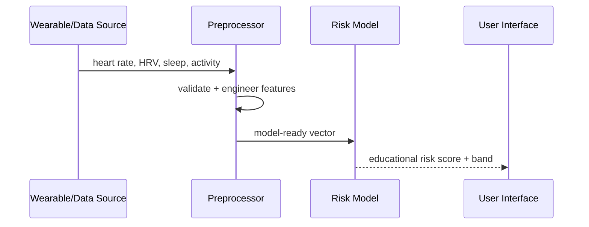

# Architecture

A production research version could replace the deterministic baseline with a validated classifier trained on appropriately consented clinical/wearable datasets, with calibration and external validation.
