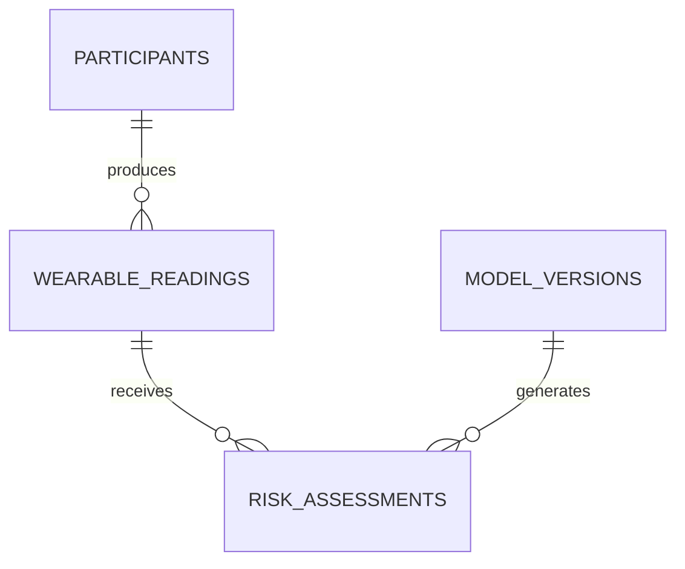

# Database Design

The local SQLite database stores synthetic/research-style wearable records and the model version used for each educational assessment.

## Data dictionary
- `participants`: pseudonymous participant reference and age.
- `wearable_readings`: resting HR, HRV, sleep and steps.
- `model_versions`: immutable identifier/description for scoring logic.
- `risk_assessments`: score, band and explanation tied to a reading and version.

## Data governance
Real health data would require explicit consent, strict access controls, encryption, minimisation, retention/deletion policies, provenance and compliance review. The repository ships only synthetic/demo data.
